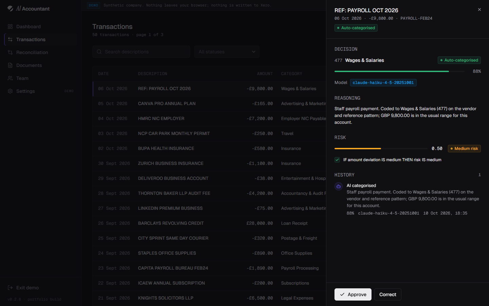
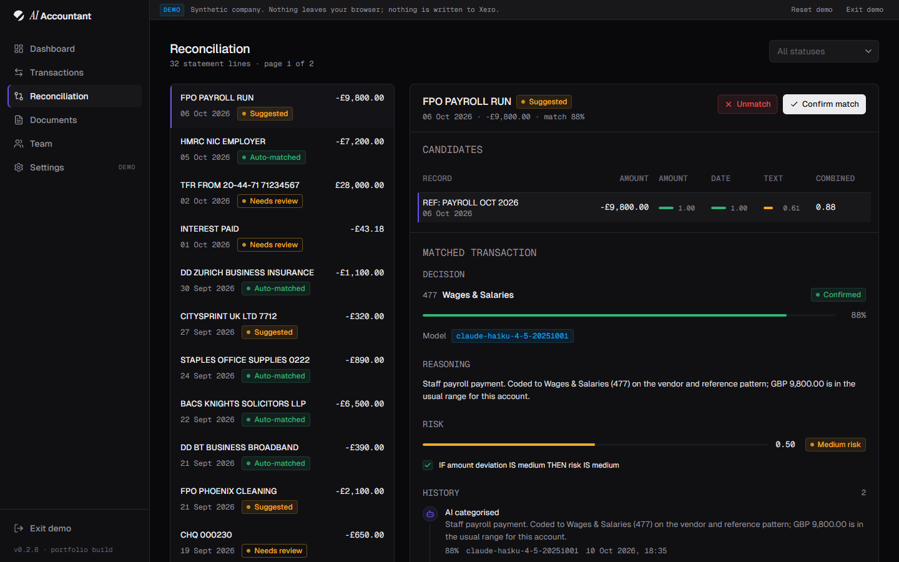
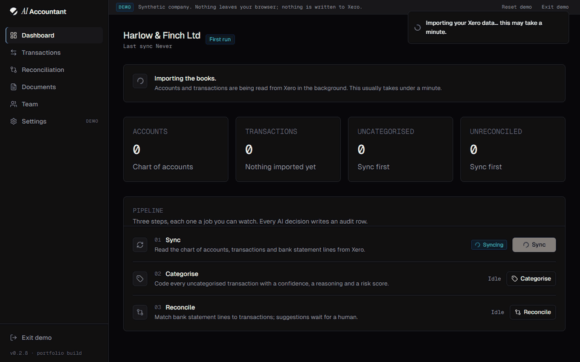
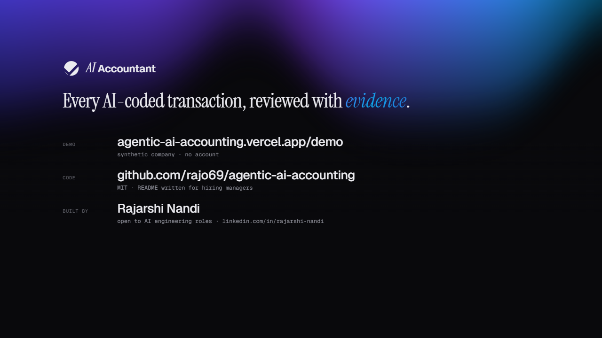
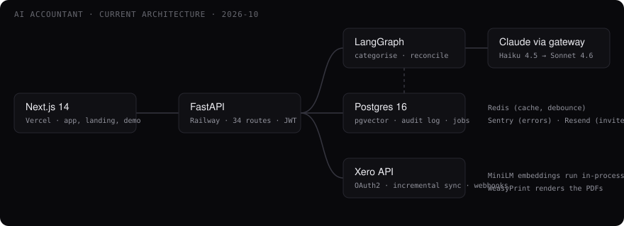

# AI Accountant

**The review layer for Xero books that AI has already categorised.** Every transaction gets a proposed category with written reasoning, a confidence tier and a risk flag. A person decides, and every decision is recorded. Deployed, open source, with a [demo that runs in your browser](https://agentic-ai-accounting.vercel.app/demo).

[](https://github.com/rajo69/agentic-ai-accounting/actions/workflows/ci.yml)
[](LICENSE)

**[Launch the demo →](https://agentic-ai-accounting.vercel.app/demo)** (runs in your browser, no account)
&nbsp;·&nbsp; **[Watch the 2-minute video →](https://youtu.be/icLQG596Ctg)**

https://github.com/user-attachments/assets/431b5bd4-40b8-466a-8d86-a41dfa1e11d9

<sup>The launch video (2:14; 1080p with chapters [on YouTube](https://youtu.be/icLQG596Ctg)), rendered from a Remotion composition in [`video/`](video/).</sup>

## At a glance

| | |
|---|---|
| Built for | UK sole traders, small businesses and the bookkeepers who sign off their books on Xero, now quarterly under Making Tax Digital. |
| What it does | proposes and explains a category for every transaction, matches bank transactions to invoices and payments, drafts the quarter's management letter, and keeps an audit trail of every AI proposal and every human decision. |
| AI | Claude Haiku 4.5, escalating to Sonnet 4.6 when unsure · structured output validated by Pydantic, through one gateway on the Anthropic SDK · LangGraph workflows · pgvector retrieval of the firm's own past decisions · risk flags from eight readable fuzzy-logic rules. |
| Stack | Python 3.12, FastAPI, SQLAlchemy 2.0 async, PostgreSQL 16 with pgvector, Redis, Alembic · Next.js 14, TypeScript, Tailwind · Docker, GitHub Actions, Vercel, Railway. |
| Size | 34 API routes, 8 tables, 6 migrations, 117 backend tests run in CI. |
| Status | deployed and open source (MIT); designed and built by Rajarshi Nandi, March to October 2026. |

## Who it is for and why it exists

Quarter-end review now falls on people who never wanted it. The person I had in mind is a self-employed electrician at the kitchen table on a Sunday evening, two days before a quarterly update is due, scrolling through three months of bank lines that Xero's AI has already categorised and trying to work out which of the hundred green ticks not to trust. And the accountant with forty of those clients, who signs each quarter knowing that whatever the software got wrong is now their professional problem.

Since 6 April 2026, sole traders and landlords with qualifying income of £50,000 or more report to HMRC every quarter under Making Tax Digital for Income Tax; the threshold falls to £30,000 in April 2027 and £20,000 in April 2028. VAT-registered businesses have reported quarterly for years.

Xero's own AI, JAX, now categorises and reconciles bank transactions automatically; Xero says it reconciles with 97% accuracy. That changes the job: the books are written by a model, and what is left for the human is finding the three lines in a hundred that are wrong, and being able to show later who decided what. A green tick with no reasoning is not evidence.

AI Accountant sits after Xero's AI and before the sign-off, and makes the review short, evidenced and recorded:

- Confidence tiers say where to look, so attention goes to the uncertain cases.
- Every proposal arrives with its reasoning, and the reviewer's question becomes "do I agree?".
- A correction comes back as an example on the next similar transaction; the firm's own decisions are retrieved, and no model is trained on them.
- Before anyone asks for it, the audit row (model, confidence, reasoning, human decision) already exists.

## What it does

A quarter's review, start to finish. Everything here runs against a connected Xero organisation; nothing is a mock-up.

1. **Sync.** Connects to Xero with OAuth2 and pulls the chart of accounts, bank transactions, invoices and payments, incrementally after the first pull.
2. **Categorise.** Proposes a category for every uncategorised transaction, using the firm's own previously categorised transactions as precedents, with a confidence score, written reasoning and a tier: auto-accept, suggested or needs review.
3. **Review.** Each proposal shows its reasoning, which model made the call, and a risk flag from eight plain-language rules such as unusual amount, unseen vendor and odd timing. Approve, correct or reject; a correction becomes a precedent for the next similar transaction.

   

4. **Reconcile.** Matches unreconciled bank transactions to invoice and payment records on amount, date and description, with scored candidates; ambiguous matches go to review.

   

5. **Report.** Drafts a management letter from the actual figures, plus a profit and loss and a VAT summary, rendered as PDFs. The figures are computed in code; the model writes only the narrative.
6. **Sign off.** The audit trail answers "who decided what, and why", for every AI proposal and every human approval, correction and rejection.

Also: a small team per practice with owner and member roles, and GDPR export and erasure of everything held about an organisation.

## Try it



**The demo** at [agentic-ai-accounting.vercel.app/demo](https://agentic-ai-accounting.vercel.app/demo) opens the console on "Harlow & Finch Ltd", with fifty transactions and a quarter's statement lines. It runs entirely in your browser: match scores are computed by a browser port of the reconciler, the PDFs come from the real templates, and nothing reaches the API or Xero. Add `?skip_onboarding=1` to start with the quarter already imported.

**The video** is a two-minute product and engineering walkthrough, playable at the top of this page or [on YouTube](https://youtu.be/icLQG596Ctg) with chapters; [`video/README.md`](video/README.md) says how it was made.

[](https://youtu.be/icLQG596Ctg)

**The live app** at [agentic-ai-accounting.vercel.app](https://agentic-ai-accounting.vercel.app) is the deployed build behind the demo: the same console, talking to the FastAPI service and to Xero through OAuth2 instead of to an in-browser fake. To connect your own books, [run it locally](#run-it-locally) with your own Xero app and Anthropic key. The consent screen asks for read-only access to bank transactions, invoices, contacts, payments and settings; transaction details, which can include payee names, are sent to Anthropic for categorisation; tokens are stored encrypted; and an organisation's data can be exported or erased. The [privacy policy](https://agentic-ai-accounting.vercel.app/privacy) lists every processor.

## Architecture

A Next.js console talks to a FastAPI service; a LangGraph categoriser and the document service call Claude through one structured-output path, and a second LangGraph workflow reconciles without a model; Postgres holds the books, the vector precedents and the audit log; Xero sits behind a single adapter that only reads.



| Layer | What runs there |
|---|---|
| Frontend | Next.js 14 (App Router), TypeScript, Tailwind, Base UI primitives, on Vercel. Landing page, review console and the browser-only demo, all calling the API through one `apiFetch` function (plus one direct call that downloads generated PDFs) |
| API | FastAPI, Pydantic v2, SQLAlchemy 2.0 async, Alembic, on Railway (Docker). 34 routes: 31 under `/api/v1`, two OAuth, one health |
| Workflows | Two LangGraph state machines in `backend/app/agents/`: the categoriser and the reconciler |
| Models | Claude Haiku 4.5 (pinned snapshot) first, Claude Sonnet 4.6 on low confidence and for document narratives, all through one gateway (`llm_client.py`) on the Anthropic SDK |
| Retrieval | pgvector in the same Postgres; `all-MiniLM-L6-v2` embeddings (384 dimensions) computed in-process |
| Data | PostgreSQL 16, eight tables, six migrations, `NUMERIC(12,2)` and `Decimal` for money; Redis for cache and webhook debounce, optional |
| Documents | Figures in Python, narrative from Claude as structured output, Jinja2 templates rendered to PDF by WeasyPrint |
| Operations | GitHub Actions (pgvector service container, migrations, 117 tests, type check, lint), per-organisation rate limits, background jobs tracked in Postgres, optional Sentry |

**Boundaries the code keeps.** Model calls live in `services/` and `agents/`; no route makes one. The single path to Xero is `integrations/xero_adapter.py`, and it only reads. Every AI decision and every human review decision (approve, correct, reject, confirm, match, unmatch) writes an audit row. Model output arrives as a schema, so nothing is parsed from free text, and the organisation comes from the session rather than from anything the model returns.

[`docs/ARCHITECTURE.md`](docs/ARCHITECTURE.md) holds the current design and the reconciliation path on live Xero data.

## How the AI works

The model proposes, code validates and a person decides. One fixed workflow calls Claude at defined points, and no model answer is accepted without passing a schema, a chart-of-accounts check and a confidence tier; an answer that fails goes to a person.

One categorisation run (`POST /api/v1/categorise/async`):

1. **Context.** Load the chart of accounts and the five nearest previously categorised transactions of the same organisation (cosine distance on pgvector).
2. **Classify.** Send the transaction, chart and precedents to Haiku as a forced tool call; receive a `CategoryPrediction` (code, name, confidence, reasoning) validated by Pydantic. Invalid or cut-off output raises, and the transaction stays uncategorised for the next run.
3. **Escalate.** Below 0.85 confidence, the same prompt goes to Sonnet; if Sonnet fails, Haiku's answer stands. The audit row records both models and both confidences.
4. **Validate.** The proposed category must exist in the chart and the confidence must be in range; a failure zeroes the confidence so the row goes to a person.
5. **Decide.** Auto-accept above 0.85, suggested from 0.5, needs review below.
6. **Explain and record.** The fuzzy risk rules run, and the payload is attached to the audit row.

A batch runs as a background job under `asyncio.Semaphore(5)`. Reconciliation uses no model: candidates are scored on amount (0.5), date (0.2) and description similarity (0.3), with near-ties sent to review. Document narratives are the only other model call, and they never compute a figure.

## Design decisions and trade-offs

Each row is a choice, the alternative it was chosen over, and the trade-off accepted.

| Decision | Instead of | Why | Trade-off accepted |
|---|---|---|---|
| Fixed LangGraph workflows | An autonomous agent with tools | Known task shape; each node is a typed async function, testable alone, and a run ends in one audit row | Less flexible on odd cases; agentic review is a later [roadmap](docs/PRODUCTION_ROADMAP.md) phase with its own evals |
| Structured output validated by Pydantic, through one gateway | Parsing model text, the first version | Parsing silently returned wrong categories when the model added preamble | The gateway is code to keep current as the API changes per model |
| Haiku first, Sonnet below 0.85 confidence | Haiku only, or Sonnet only | The stronger model runs only where a person would otherwise look, at about 3× Haiku's list price | A low-confidence transaction makes two model calls |
| The firm's own past decisions as few-shot precedents | Fine-tuning, or a global classifier | Corrections apply on the next similar transaction; categorisation trains no model on client data | Precedents come only from the same organisation |
| Local MiniLM embeddings in the same Postgres | An embeddings API and a vector database | Anthropic has no embeddings endpoint; no extra vendor or database | PyTorch makes the backend image large |
| Risk flags from eight readable fuzzy rules | Learned per-feature contributions | An accountant can read and challenge "amount deviation is high AND vendor is rare" | Coarser than a learned model |
| `Decimal` money, figures computed in code | Floats; model-written figures | Penny errors are trust failures; the model never touches a number | The model writes only the narrative around the figures |
| An audit table row per AI and per human decision | Log lines | "Who decided what, and why" has to be queryable | A database write on every decision |
| Raw `httpx` Xero adapter behind one interface | The Xero SDK | Control over token refresh, 429 backoff and `If-Modified-Since` sync, in one file | More code to own |
| Browser-only demo behind `apiFetch` | A hosted demo backend | No running cost, no data risk; every endpoint the console calls is simulated, and reconciler scoring is ported and checked against RapidFuzz to four decimal places | Demo reasoning is replayed from the seed, not generated live |

Behind these choices are specific problems, with commits, in the [engineering record](#engineering-record).

## Evaluation

The eval harness has pass/fail gates, a calibration table and a budget guard, and the rule is that every published number sits next to a provenance file (commit, fixture version, prompt version, model id, date).

The harness in [`backend/evals/`](backend/evals/) runs fifty labelled UK small-business bank transactions generated with Claude, none taken from Xero, against twenty chart-of-accounts codes, split 31 easy, 15 medium and 4 hard. It reports accuracy by tier, per-category precision, recall and F1, a calibration table (accuracy by confidence bucket) and cost. It exits non-zero when a gate is missed: overall at least 80%, easy tier at least 95%, auto-accept bucket at least 90%. Responses are cached by model and prompt so reruns are free, and `--budget` stops a live run as soon as its recorded spend passes the cap.

The benchmark built to this categoriser's input contract (the Xero record fields it reads, the firm's chart and the top 5 retrieved precedents) is [bookbench](https://github.com/rajo69/bookbench): 1,000 UK and US small-business transactions with precedent history, `NEEDS_REVIEW` as a gold answer and a separately scored stratum of instruction-like text. It is public as a draft ([data on Hugging Face](https://huggingface.co/datasets/rajo0113/bookbench)), and no model has been scored on it yet.

What the harness measures: its own prompt, isolated from precedent retrieval and routing, so a result belongs to the prompt alone; the four-item hard tier is read as a diagnostic split; the gates run in the runner. The measurement plan, in order: a baseline of the production graph, retrieval and routing included, replayed on bookbench, then Haiku-only against Sonnet-only against tiered.

```bash
cd backend && python -m evals.eval_runner --mode mock    # no API calls
```

Research questions the build raised: whether confidence should be calibrated per organisation when each firm has little labelled data; whether explanations change review time and correction rate; and whether choosing review candidates actively reduces corrections compared with arrival order.

## Explainability and risk scoring

Two different things sit behind the explanation panel, and the console keeps them apart.

- The model's reasoning is the `reasoning` field of the structured output, shown to the reviewer beside the proposal.
- The risk flag is glass-box. A Mamdani-style fuzzy inference engine, written from scratch in [`backend/app/xai/fuzzy_engine.py`](backend/app/xai/fuzzy_engine.py), takes three normalised inputs (amount deviation from the category's history, vendor frequency, weekday or weekend timing), applies eight plain-language rules, and returns a score, a label (low, medium, high) and the rules that fired. Defuzzification is a centroid over term representatives.

## Security and data handling

Tenant isolation, token handling and webhook verification held up under review.

- Every authenticated operation is scoped to the organisation from the session, checked route by route in the [self-review](docs/SELF_REVIEW.md).
- Xero tokens are Fernet-encrypted at rest; webhooks are verified with HMAC-SHA256 and `compare_digest`; the JWT algorithm is pinned both ways.
- The app never writes to Xero.
- The frontend has no XSS sinks or open redirects; rate limits are per organisation with `Retry-After`.
- GDPR export excludes tokens and embeddings; erasure deletes in foreign-key-safe order and invalidates the session.

**Where data goes.** Anthropic receives transaction date, amount, description (which can include payee and customer names), reference, the chart of accounts and a few precedents, plus aggregated figures for narratives. Railway hosts the API and database, Vercel the frontend; Sentry receives error reports tagged with the organisation when enabled; Resend sends invitation emails.

**Xero developer terms.** API data may not be used to train, fine-tune, adapt or enhance AI models (clause 7(b)(i)) or be passed to a third party without the user's consent (7(b)(ii)). Precedent retrieval is in-context, with no fine-tuning on Xero data, and the evaluation fixtures contain no Xero data.

## Engineering record

Problems that needed judgement, in brief. The long form, with commit links, is in [`docs/ENGINEERING_RECORD.md`](docs/ENGINEERING_RECORD.md).

- Xero changed its OAuth scope scheme mid-build. Apps created after 2 March 2026 must use granular scopes, and the broad ones returned `unauthorized_client`. I found the working names by testing against the token endpoint, then caught a later commit that silently reintroduced a broad scope by cross-checking git history against Xero's scope table.
- A CORS "improvement" took the production dashboard down in a loop. Every `fetch` threw a `TypeError` with no status, which the dashboard read as "Xero not connected", while OAuth (a redirect, immune to CORS) kept working. Diagnosed by telling a browser-level CORS failure apart from a 401.
- Anthropic has no embeddings endpoint. Split the concerns: local MiniLM embeddings off the event loop with `asyncio.to_thread`, and a migration shrinking the vector column from the OpenAI size.
- Parsing model text produced wrong categories without raising. Replaced with structured output (Instructor at first, now one gateway on the Anthropic SDK), so a Pydantic model is the contract and invalid output fails instead of persisting.
- Xero's Demo Company bank lines are invisible to the API. Added a Payments source with deduplication against invoices, so on live data the reconciler matches bank transactions to invoices and payments.
- A dependency release took the API down for an afternoon. SQLAlchemy 2.1 shipped, the unpinned range resolved to it, and `postgresql://` now defaulted to a driver the image lacked. Pinned, redeployed and verified within the afternoon.
- I reviewed my own code. Six parallel review passes, run as Claude Code agents under one evidence standard (file, line, quoted code, severity), produced 106 findings, 14 high, none critical; the numerical ones were reproduced before being recorded. Method and top findings: [`docs/SELF_REVIEW.md`](docs/SELF_REVIEW.md).
- Findings fixed test-first. Five defects from the self-review, each pinned first by a test that failed: spend subtypes stored as money in, a risk engine that scored the most extreme inputs "medium", validation that stored the model's paraphrase instead of the chart's account name, PDF templates that rendered untrusted text unescaped with an open URL fetcher, and three write scopes the app never used.
- The demo had to be honest and complete at once. An in-browser server behind `apiFetch` answers every endpoint the console calls from a seed generated from the eval fixtures; every action does visible work from every entry point; no request reaches the API or Xero (checked in headless Chrome against production).
- The launch video is a Remotion render. Script first, narration synthesised per beat, every word timed with whisper; every visual event starts on its sentence and every caption on its spoken word; product footage is the landing page's own components. Swapping the narrator's voice cost one regeneration and one render. See [`video/README.md`](video/README.md).

## Run it locally

**To run the demo**, Node 20 is enough: `cd frontend && npm install && npm run dev`, then open `http://localhost:3000/demo`.

**The full app** needs Docker Desktop, Python 3.12 and Node 20, plus a Xero app and an Anthropic key.

```bash
git clone https://github.com/rajo69/agentic-ai-accounting
cd agentic-ai-accounting
docker compose up -d                      # Postgres 16 with pgvector, Redis 7

cd backend
cp .env.example .env                      # XERO_CLIENT_ID, XERO_CLIENT_SECRET, ANTHROPIC_API_KEY
pip install -e ".[dev,ai,docs]"           # sentence-transformers pulls PyTorch (large)
alembic upgrade head
uvicorn app.main:app --reload --port 8000

# then, in a second terminal at the repository root:
cd frontend
npm install
npm run dev                               # http://localhost:3000, with NEXT_PUBLIC_API_URL=http://localhost:8000
```

The Xero app needs the redirect URI `http://localhost:8000/auth/xero/callback`. WeasyPrint needs Cairo and Pango for PDFs. Everything in `backend/.env.example` is the complete set; Sentry, Resend and the webhook key are optional.

**Tests.** `cd backend && pytest -q` runs 117 tests in 12 files offline, with Xero, Anthropic and the database session mocked; `cd frontend && npx tsc --noEmit && npm run lint && npm run build` checks the frontend. CI starts a pgvector Postgres service, applies the migrations, runs the backend suite, then the frontend type check and lint.

<details>
<summary><strong>Repository map</strong></summary>

```
backend/
  app/
    api/v1/          auth, sync, dashboard, categorise, reconcile, documents, explanations, gdpr, webhooks, jobs
    agents/          categoriser.py, reconciler.py (LangGraph)
    services/        embedding_service.py, document_service.py
    integrations/    xero_adapter.py
    xai/             fuzzy_engine.py, explainer.py
    core/            config, database, session (JWT), encryption, cache, jobs, rate_limit, observability, email
    models/          SQLAlchemy models, Pydantic schemas
    templates/       management_letter.html, profit_loss.html, vat_summary.html
  alembic/           six migrations
  tests/             twelve files, 117 tests
  evals/             harness, fixtures (50 transactions, 20 accounts), cost tracker, cache
frontend/src/
  app/               landing, dashboard, transactions, reconciliation, documents, team, settings, demo, privacy, auth/callback
  components/        app shell, sidebar, explanation panel, landing/*, app/*, ui/*
  demo/              fake server, seed, store, jobs, reconciler port
  lib/               api.ts (apiFetch and types), motion presets
video/               the launch video as a Remotion project
docs/                ARCHITECTURE, ENGINEERING_RECORD, PRODUCTION_ROADMAP, SELF_REVIEW, media/
```

</details>

## About

Designed, built and documented by **Rajarshi Nandi** · [GitHub](https://github.com/rajo69). Further reading: [architecture](docs/ARCHITECTURE.md) · [engineering record](docs/ENGINEERING_RECORD.md) · [self-review](docs/SELF_REVIEW.md) · [roadmap](docs/PRODUCTION_ROADMAP.md) · [eval harness](backend/evals/README.md) · [bookbench](https://github.com/rajo69/bookbench) · [how the video was made](video/README.md) · [changelog](CHANGELOG.md).

**How it was built.** With Claude Code as the implementer: it wrote the code and drafted the documentation. My part was the product and its scope (the UK MTD and Xero framing, what to build and what to cut), the architecture and its trade-offs (the stack, the two LangGraph workflows, Haiku first with Sonnet on low confidence, the review-layer positioning), and the verification: I read the diffs, ran and tested the app, and decided which review findings and which claims in these docs to accept. The six self-review passes and the fact-checks of these docs ran as parallel Claude Code agents under one evidence standard: file, line and quoted code for every finding.

MIT licence; see [LICENSE](LICENSE). Not a registered accountancy service.
